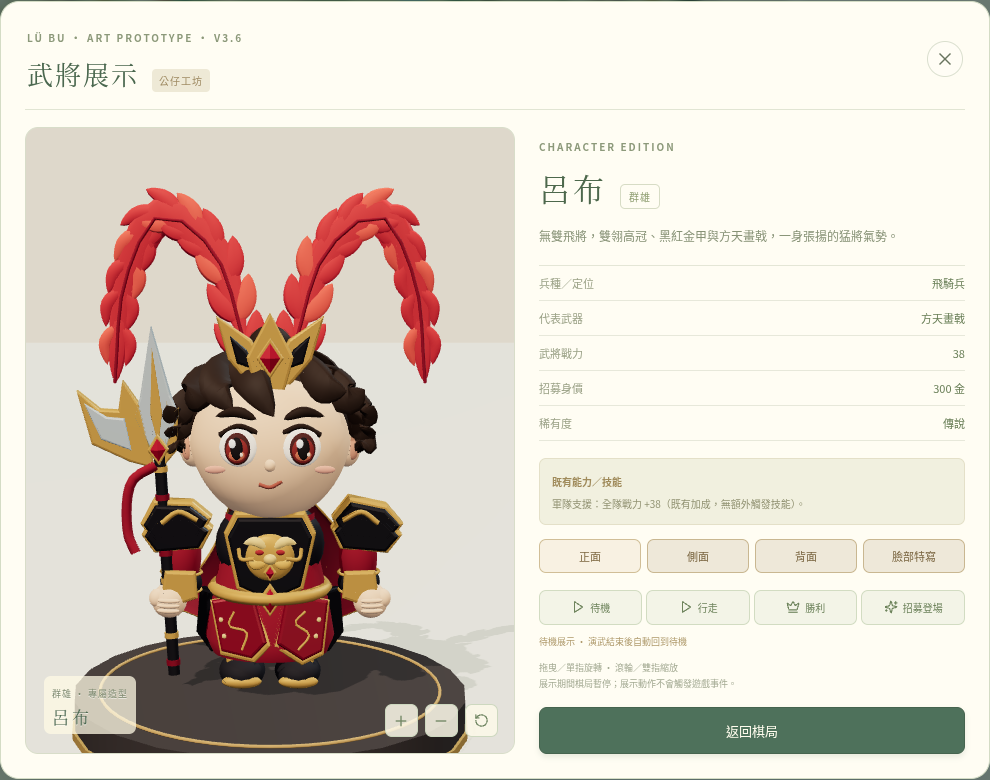
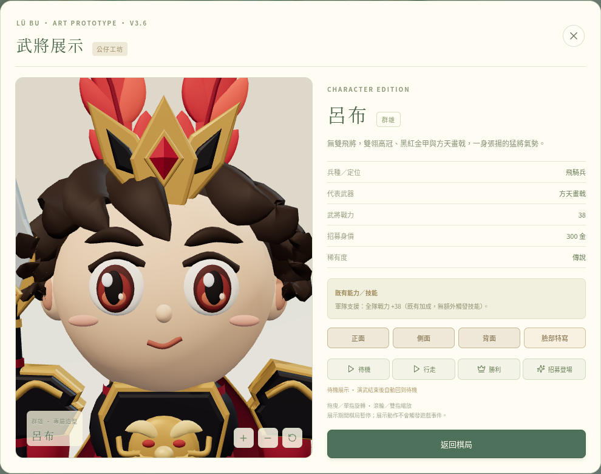
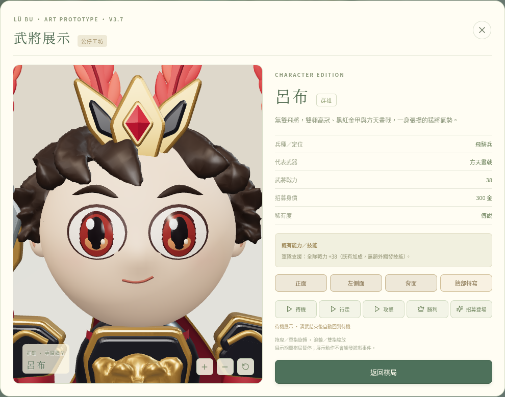

# V3.7 呂布公仔精修

以最新 main `2b99ab8`（V3.6 已合併）建立 `feat/v3-7-premium-lubu`。本版只處理呂布的模型、PBR 材質、展示及純視覺動畫；其他七位人物、四主公棋子、24 格棋盤、遊戲規則、數值、存檔與 Pages 工作流程保持原樣。

**交付的是經 Blender 腳本處理、可在遊戲實際操作的精修模型。它仍未達專業手工雕製的收藏級 PVC 公仔品質。美術差距列在下方，功能測試不作為美術達標的證明。**

## 真實遊戲畫面與 V3.6 比較

[正面](screenshots/front.png) · [左側面](screenshots/left.png) · [背面](screenshots/back.png) · [臉部特寫](screenshots/face.png) · [預設角度](screenshots/hero.png)

V3.6 對照圖取自 main 中已保存的真實遊戲截圖；V3.7 圖由本分支正式建置、Three.js 實際載入 GLB 的展示視窗擷取。兩版保留原本的自動取景，鏡頭目標會隨模型尺寸調整；圖中的比例與燈光變化也包含各版展示設定。可點開原圖檢查細節。

| 視角 | V3.6 實際畫面 | V3.7 實際畫面 |
| --- | --- | --- |
| 正面 |  |  |
| 臉部 |  |  |

截圖使用「減少動態效果」設定以避免眨眼，並以隔離的瀏覽器測試存檔展示已擁有的呂布。正式招募規則沒有修改。

## 實際模型修改

| 項目 | V3.6 | V3.7 交付 |
| --- | --- | --- |
| 比例 | 較短的身體 | 頭部主體高度：下巴以下身體約 **1：1.28**，接近要求的 1：1.3；不計頭冠與羽翎。胸甲／腰甲區向上延長，仍維持大頭短肢 |
| 臉部 | 分離的眼球、腮紅與小鼻部件 | 連續臉部控制網格加 Blender 曲面細分；鼻部輪廓併入網格，腮紅採頂點顏色漸層。多層眼片依臉部曲面貼合，紅瞳、瞳孔、高光與光澤材質分開 |
| 髮型 | 相交的曲線髮束 | 曲線控制體經 Blender 體素融合、平滑與減面，保留額前尖收及後腦髮流。仍有過圓／不夠精緻的轉折，見美術限制 |
| 羽翎 | 較大的雙紅羽 | 各自以根部為基準 **0.8 倍縮放**，羽片變細並增加層數；獨立左右關節提供極輕微跟隨擺動 |
| 盔甲 | 較硬的多角甲片與簡化獸面 | 甲片輪廓圓角及三維倒角、獨立金框與黑甲；獸首控制體經 Blender 融合成具有厚度的浮雕。裙甲仍為有厚度的分片網格，金紋保留立體結構 |
| 材質 | 以霧面配方為主 | 皮膚霧面 PVC、半霧面深棕髮、微光澤黑漆、霧面紅甲、金屬金／銀與光澤寶石。使用 MeshStandardMaterial／glTF 金屬粗糙度 PBR |
| 光影 | 方向光展示 | 呂布專用、由 Three.js RoomEnvironment 產生的低解析度 PMREM 環境反射，搭配主光與補光；臉部保留柔和法線明暗並避免接收頭冠硬陰影。沒有 Bloom。腳底與展示台頂面對齊，展示台仍接收模型陰影 |
| 畫戟 | 立體刃片與接頭 | 增厚主刃、月刃及倒角，銀灰金屬、金色脊線與雕刻線；掌心關節固定握持，攻擊向身體外側／前方揮動 |
| 動作 | 待機、行走、勝利、招募 | 保留前述動作，加入展示用攻擊演武；有蓄力、揮擊與回收。眨眼採不等間隔節奏，包含偶爾雙眨；眉毛、羽翎與披風輕微跟隨 |

攻擊演武僅由展示層播放；動畫不消耗遊戲亂數，也不寫入遊戲狀態。站立時雙腳固定於展示台，行走時依鞋底輪廓補償腳的高度。手機仍可使用低畫質模式與觸控旋轉／縮放。

## GLB 位置、預算與新版快取確認

| 用途 | 模型檔案 | 大小 | 三角形 | 網格部件 |
| --- | --- | --- | --- | --- |
| 低畫質／頭像 | [lubu-board.glb](../../src/assets/lubu-board.glb) | 1,370,812 bytes | 38,148 | 66 |
| 標準展示 | [lubu-display.glb](../../src/assets/lubu-display.glb) | 3,047,380 bytes | 94,730 | 66 |

兩個 LOD 共用設計與關節結構；每次展示擁有自身幾何與材質，CPU 模板快取上限兩份。PMREM 與 renderer 在展示關閉時釋放。原型曲面備援保留同版造型，但沒有 Blender 後處理，畫面會明示細節較低。

- GLB 根節點實際標記 `artRevision: 3.7.0`、`meshPipeline`，載入器拒絕舊版標記或缺少關節的模型。
- Vite 打包採內容雜湊檔名，並沿用 `/sanguo-monopoly/` base。
- 正式版驗收除了查看畫布版本，還會讀取瀏覽器真正下載的兩份 GLB，逐一比對 [建模紀錄](model-build.json) 的 SHA-256。
- [瀏覽器驗證紀錄](screenshots/verification.json) 記錄子路徑資源 HTTP 200、版本與 SHA 相符、無 console／page／requestfailed 錯誤，以及展示前後存檔相同。

## 可維護的製作流程

本環境已確認有 **Blender 4.3.2**。本版確實執行了下列流程，不是僅修改 CSS、燈光或鏡頭：

1. [lubuArt.ts](../../src/three/lubuArt.ts)：呂布專屬控制網格、貼合眼片、頂點腮紅、分層甲片、獸首、髮束、羽片、材質與比例。
2. [build-lubu-model.mjs](../../scripts/build-lubu-model.mjs)：輸出控制 GLB，呼叫 Blender，遇到 Python 錯誤回傳失敗。
3. [polish-lubu.py](../../scripts/polish-lubu.py)：保留節點關節，對指定髮束／獸首做體素融合、平滑和減面；對獨立臉網格做曲面細分，再輸出真正 glTF 2.0 二進位模型與 SHA／三角形紀錄。兩種 LOD 各有預算檢查。
4. [lubuAsset.ts](../../src/three/lubuAsset.ts)：驗證版本及節點、建立獨立實例，沿用原有共用工廠及展示架構。
5. [lubuAnimation.ts](../../src/three/lubuAnimation.ts)、[lubuLighting.ts](../../src/three/lubuLighting.ts)：呂布專用關節動畫及環境反射；其他角色保持原本行為。

重建資產需 Node.js 24 與 Blender 4.3：

```bash
node --experimental-transform-types scripts/build-lubu-model.mjs
```

可用 `BLENDER_PATH` 指定 Blender 執行檔。Pages 建置使用已提交的 GLB，無需在 GitHub Actions 安裝 Blender。未下載第三方人物模型，沒有付費素材／API 金鑰依賴；環境反射使用既有 Three.js 的 MIT 授權 RoomEnvironment。

如果後續改為人工雕模，請保留 GLB 的角色根節點及頭部、左右手腳、眼睛、眉毛、羽翎、披風、掌心握點介面；人工成果應成為新的來源，避免再被原型匯出腳本覆蓋。

## 尚未達到收藏級的美術要求

- **髮束精雕**：自動體積融合仍有轉折過圓、髮溝節奏不夠清楚的地方；需要人工調整額前髮流與長短髮束。
- **臉部塑形**：眼片貼合與表面連續性已有改善，但鼻部在正面仍不夠鮮明；眼瞼、鼻翼、嘴角和臉頰需要美術師雕形與表情推敲。
- **羽毛細節**：已縮小並分層，仍缺自然細羽枝、羽絲刻紋與手工修整的厚薄節奏。
- **獸首與雕花**：有真實三維厚度，但眼鼻、鬃毛、牙齒及金色裙甲紋樣仍屬簡化造型，需要人工精雕與設計。
- **材質紋理**：尚未製作精密手繪／烘焙貼圖、布料織紋與細微表面紋理；披風仍是關節擺動，沒有布料物理。
- **完整美術驗收**：沒有宣稱已通過專業收藏級公仔美術審核。實體 Android／iPhone 的 GPU 幀率、發熱與所有機型相容性仍待裝置確認。

## 驗證

使用 `npm ci`、`npm test`、`npm run build`、`npm run test:e2e`。測試包括原有遊戲規則、全角色展示、逐格行軍與轉向、存檔與備援，以及呂布 GLB 解碼、LOD 預算、獨立資源、姿勢避讓、頭身比例、PBR、五種動作、手機觸控與舊模型拒絕。單元測試共 28 項、瀏覽器測試共 19 項。

實際截圖由正式建置擷取，重現方式：

```bash
npm run build
node --experimental-transform-types scripts/review-lubu.mjs
```

截圖工具使用 Chromium；可用 `CHROMIUM_PATH` 指定位置。它會以隔離的測試存檔操作本機正式產物，不會部署 GitHub 或變更正式玩家存檔。Chromium 驗證使用軟體 WebGL，不能取代美術判斷或實體手機效能測試。正式建置仍有 Three.js 共用 chunk 大於 500 KB 的大小提示，並非建置錯誤。

完整回歸曾在既有行軍測試的固定 350 毫秒取樣讀到上一個 WebGL 幀；已將取樣同步改為等待同一幀同時具備行軍狀態、實際位移及擺腿。逐格順序、到站招募與存檔斷言全部保留，沒有調整遊戲時序。

最終驗收結果：`npm ci` 成功；`npm test` **28 項通過**；`npm run build` 成功；`npm run test:e2e` **19 項通過**。行軍專項另連續重複 2 次通過。
