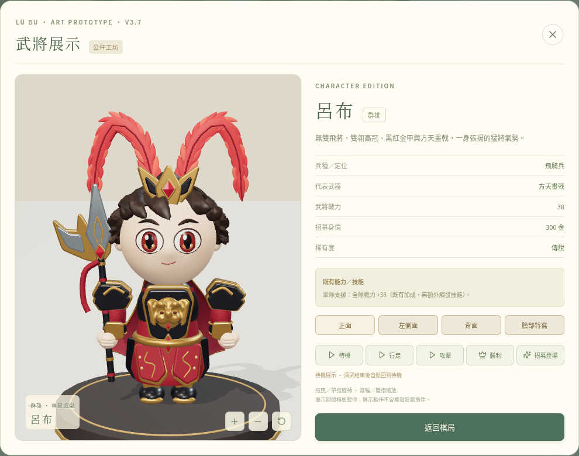
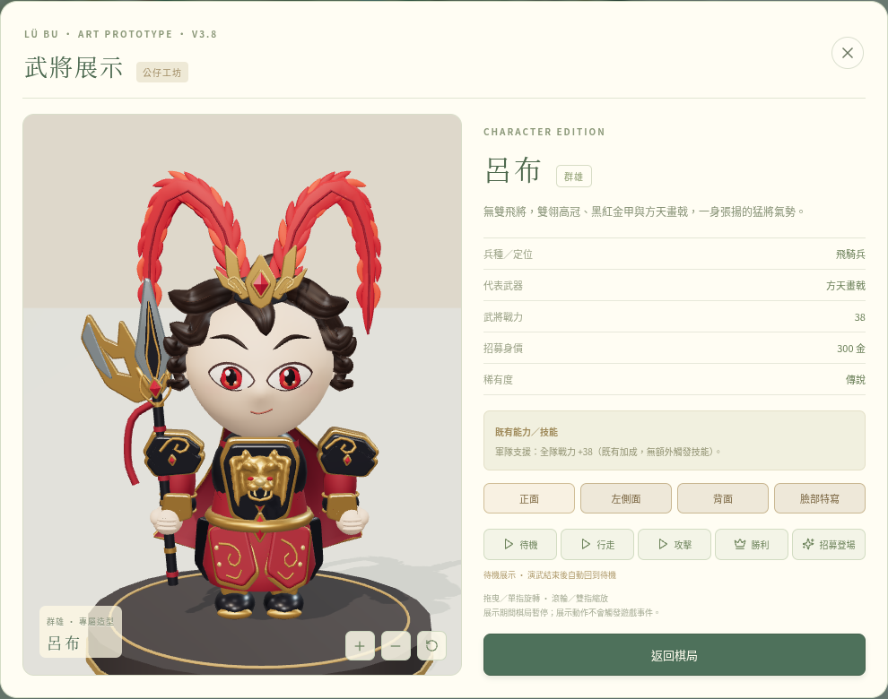
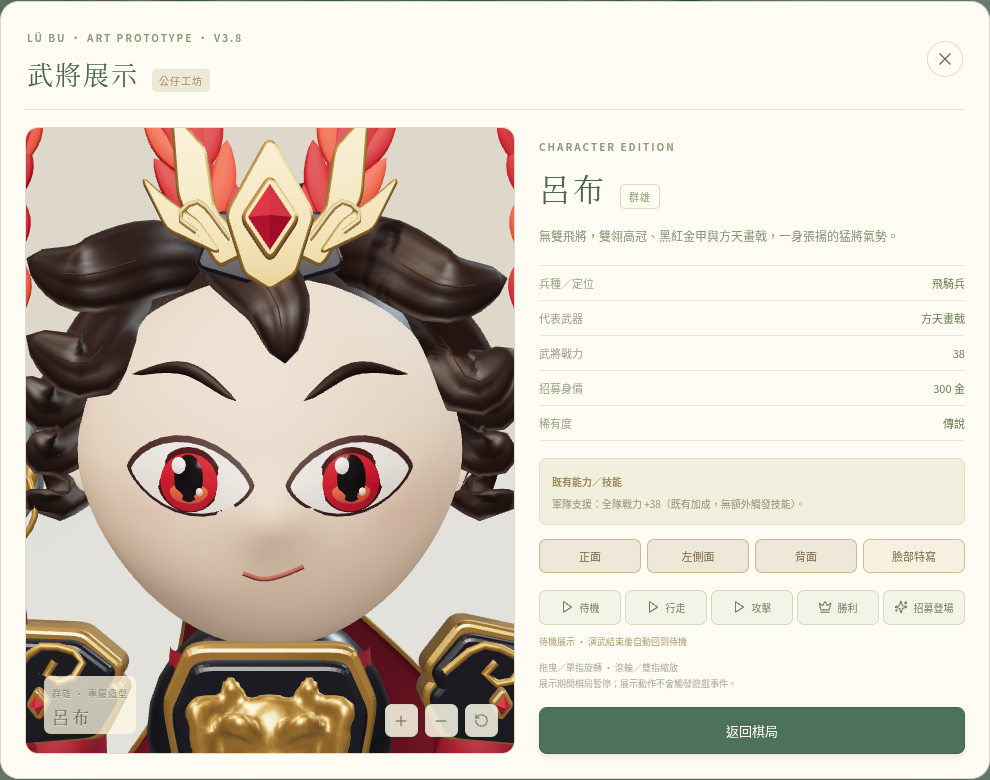
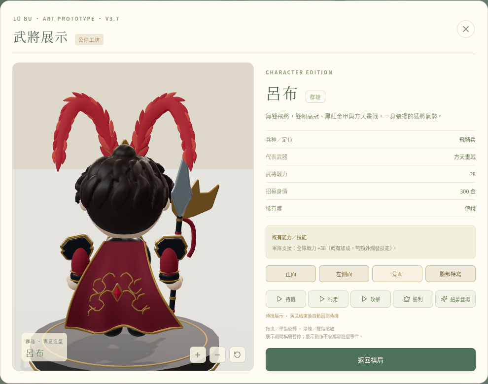
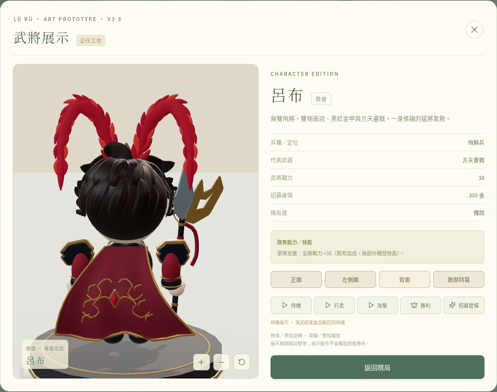

# V3.8 呂布造型重製

從檢查時最新 main `2b99ab8` 建立 `feat/v3-8-lubu-art-redesign`。當時 main 仍是 V3.6，V3.7 的 `d4b9a90` 尚未合併，因此本分支接續該提交，再完成 V3.8 重製；本 PR 可一次帶入所需基礎，不需要先合併 V3.7。main 沒有被修改或部署。

以本次對話正式確認的紅眼、深棕側掃髮、黑金紅甲呂布參考圖為主要視覺依據。**本版確實修改三維幾何及材質，但仍未接近附圖的專業收藏級雕模精度，也沒有宣稱完整還原。** 下方將實作、測試及仍需專業 Blender 人工處理的內容分開列出。

## 實際 GLB 遊戲渲染

[正面](screenshots/front.png) · [左側面](screenshots/left.png) · [背面](screenshots/back.png) · [臉部特寫](screenshots/face.png) · [預設角度](screenshots/hero.png)

截圖由正式建置的遊戲武將展示視窗擷取。使用隔離的瀏覽器測試存檔直接展示已招募的呂布，並啟用減少動態效果以避免眨眼；沒有改正式招募規則，沒有把參考圖貼在人偶上。

### 與 V3.7 的真實畫面比較

V3.7 對照取自該提交已保存的實際遊戲截圖。V3.8 沿用 V3.7 的展示光照與鏡頭程式；自動取景仍會依模型邊界調整，造型差異來自新 GLB。

| 視角 | V3.7 | V3.8 |
| --- | --- | --- |
| 正面 |  |  |
| 臉部 |  |  |
| 背面 |  |  |

## 造型實作與參考圖差距

| 參考圖重點 | V3.8 實作 | 尚需專業雕模的部分 |
| --- | --- | --- |
| 大頭小身、帥氣可愛的臉型 | 保留約 2.3 頭身；縮窄下巴輪廓，調整眼、眉、鼻、嘴的位置與微笑曲線 | 眼眶、鼻翼、嘴角、臉頰與下巴的精細塑形仍簡化，鼻部正面辨識度不足，尚未達到參考圖的人物神韻 |
| 紅色杏仁眼與自信眉型 | 重製貼合臉部的杏仁眼片、紅瞳與多層高光；眉型改得較銳利，保留動畫微變 | 眼瞼厚度、眼窩過渡、眼神與表情仍需人工推敲，沒有專業面部拓撲或表情雕形 |
| 深棕分層側掃髮 | 改為獨立設計的扁闊側掃髮束、外翹尖收、後腦髮流與幾何髮溝，保留分層而不做髮束體素融合 | 部分髮束仍過於規整、轉折與髮根銜接不夠自然；細髮刻紋、層次節奏及手繪髮質需要人工製作 |
| 金冠紅寶與雙紅羽翎 | 重製冠飾比例、薄金色焰形翼與雲紋，調整冠飾高度使中央紅寶露出；保留分層雙紅羽與輕微跟隨動作 | 冠飾複雜鏤空、羽絲、細羽枝與自然厚薄節奏尚未達參考圖 |
| 獸首胸甲與黑金紅盔甲 | 增加獸首鬃邊、耳部、紅眼、立體鼻口、暗色口腔層與金色牙飾；肩甲、護腕、裙甲加入雲紋和小紅寶 | 獸首眼鼻、牙齒與鬃毛仍為簡化雕形，尚無精密金屬鑿刻；甲片輪廓、細密紋樣與材質表面需專業精修 |
| 華麗方天畫戟 | 重製銀刃、黑色中脊、金色邊線、接頭紋飾與紅纓；月刃包含真正可透射光線的孔洞 | 盤龍、複雜鏤空、刃面折線及精密雕花仍不及參考圖，需人工建模與烘焙 |
| 紅色披風 | 加寬並調整外擴曲線，保留封閉厚度、褶皺、金色包邊與紋章 | 動態布褶、織紋、圖案設計與細緻金繡尚未製作；沒有布料物理 |
| 收藏公仔材質 | 沿用霧面 PVC、深棕半霧面髮、微光澤黑甲、紅漆、金銀 PBR 與光澤紅寶；眼色調整為鮮明紅色 | 尚無精密 UV／手繪／法線／粗糙度烘焙貼圖，表面質感與專業棚拍效果仍有距離 |

待機、行走、攻擊、勝利、招募登場五種動作保留，按鈕與模型關節連動；可拖曳 360 度旋轉、滾輪或雙指縮放、切換三視圖與臉部特寫。攻擊只在展示層演武，不改自動戰鬥結算。

## 真正的模型與主要修改檔案

| 用途 | GLB | 大小 | 三角形 | 網格部件 |
| --- | --- | --- | --- | --- |
| 低畫質／頭像 | [lubu-board.glb](../../src/assets/lubu-board.glb) | 1,212,376 bytes | 40,634 | 71 |
| 標準展示 | [lubu-display.glb](../../src/assets/lubu-display.glb) | 2,686,408 bytes | 99,658 | 72 |

[建模輸出與 SHA-256 紀錄](model-build.json)。GLB 為 glTF 2.0 二進位，包含完整頭、身、手腳、衣甲、武器與動畫關節。兩個 LOD 共用設計；標準模式保留較細髮溝與髮束高光線，低畫質保留相同輪廓。

- [lubuArt.ts](../../src/three/lubuArt.ts)：控制網格與 PBR 材質、杏仁眼、側掃髮束、髮溝、冠飾、獸首、衣甲、披風與鏤空畫戟。
- [polish-lubu.py](../../scripts/polish-lubu.py)：Blender 4.3.2 匯入控制網格、臉部細分、獸首融合／平滑／減面、曲面法線整理，保留獨立髮束與關節後匯出 GLB。流程仍是自動腳本，建模紀錄明示 `manualSculpt: false`。
- [build-lubu-model.mjs](../../scripts/build-lubu-model.mjs)：建立兩種 LOD，呼叫 Blender 並檢查錯誤及網格預算，兩份模型都成功後才更新正式資產與紀錄。
- [lubuAsset.ts](../../src/three/lubuAsset.ts)：沿用官方 GLTFLoader、版本與關節驗證及獨立資源實例。
- [lubuAnimation.ts](../../src/three/lubuAnimation.ts)：保留 V3.7 的展示動作及不規則眨眼／跟隨動作。

重建需 Node.js 24 和 Blender 4.3：

```bash
node --experimental-transform-types scripts/build-lubu-model.mjs
```

可用 `BLENDER_PATH` 指定 Blender。GitHub Pages 直接使用已提交的 GLB，不需在部署機器安裝 Blender。正式模型目前沒有貼圖，因此移除無用途的 UV 通道以減少載入量，保留臉部頂點色；後續人工貼圖製作需要重新展 UV。沒有付費服務、API 金鑰或第三方角色模型依賴。

後續人工編修可匯入展示 GLB，保留既有節點與掌心握點；`Face_PVC`、`Eye_White_Almond`、`Hair_Locks`、`Beast_Relief`、`MoonBlade_Pierced` 提供可辨識的編修部件。人工成果應改為新的模型來源，避免被控制網格腳本覆蓋。

## 驗證與保留功能

- 執行乾淨安裝、正式建置、單元與瀏覽器測試。
- 既有棋盤、骰子、逐格移動、招募、隨機事件、自動戰鬥、圖鑑、存檔、2D 備援及 Pages 流程保留；遊戲規則、數值與棋盤渲染檔沒有修改。
- 專項檢查 GLB 解碼、LOD 預算、骨節與握點、獨立資源、頭身比例、動作避讓、PBR 材質、杏仁眼比例，以及月刃孔洞的真實光線穿透。
- [正式版瀏覽器驗證紀錄](screenshots/verification.json) 確認畫布使用 `3.8.0`、瀏覽器實際下載內容的 SHA-256 與建模紀錄一致；GLB／JS／CSS 均在 `/sanguo-monopoly/` 正常載入，沒有 pageerror／console error／requestfailed，展示前後存檔相同。
- 保留並測試拒絕舊版 GLB、下載失敗時的新版曲面備援、手機低畫質與觸控；備援沒有 Blender 後處理，畫面會明示細節較低。

重現正式版截圖：

```bash
npm run build
node --experimental-transform-types scripts/review-lubu.mjs
```

使用 Chromium，可用 `CHROMIUM_PATH` 指定。此工具以隔離的測試存檔操作本機正式產物，不會部署或修改正式玩家存檔。截圖／自動測試使用軟體 WebGL，尚未驗證實體 Android／iPhone 的 GPU 幀率與發熱。測試成功只證明功能和載入，不能替代專業美術驗收。正式建置仍有 Three.js 共用 chunk 大於 500 KB 的提示，並非建置錯誤。

### 最終驗收結果

- `npm ci`：成功，沒有新增依賴或改動鎖定檔。
- `npm test`：**29 項通過**。
- `npm run build`：成功。
- `npm run test:e2e`：**19 項通過**。
- 正式版四視圖與預設角度實際渲染成功，兩個 GLB 的 SHA-256 相符，資源載入與存檔檢查通過。

以上結果不代表已達附圖的美術精度；請先檢視真實比較圖，確認品質後再決定是否合併。
